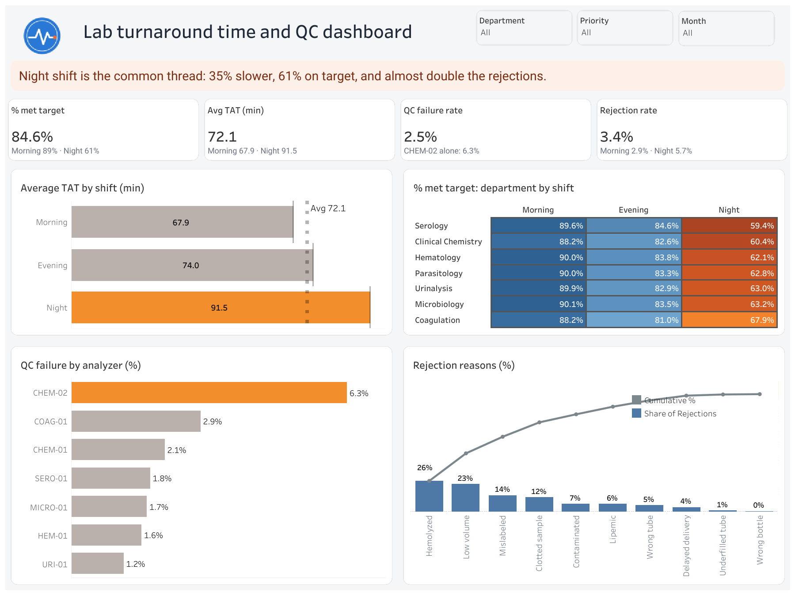

# LabPulse: Lab Turnaround Time & QC Analysis

**Why is the night shift slower?** An end-to-end analytics project using 50,000 simulated clinical laboratory records to find where results are delayed and what is causing it.

> **Note:** All data in this project is **simulated**. No real patient, hospital, or employer data was used.



**[View the interactive dashboard on Tableau Public]([PASTE-YOUR-TABLEAU-LINK](https://public.tableau.com/views/LabTAT_17919070053590/Dashboard?:language=en-US&publish=yes&:sid=&:redirect=auth&:display_count=n&:origin=viz_share_link))** · **[Read the full case study](PASTE-YOUR-CASE-STUDY-LINK)**

---

## Project summary

In a medical laboratory, a late result can be almost as risky as a wrong one. This project analyzes turnaround time (TAT), quality control (QC) failures, and sample rejections to answer one question:

> **Where is the lab losing time, and what is driving it?**

I built the dataset with Python, analyzed it with SQL, and visualized it in Tableau. The analysis points to one theme: the **night shift**.

## Key findings

| Metric | Morning | Evening | Night |
|---|---|---|---|
| Average TAT (min, excl. microbiology) | 67.9 | 74.0 | 91.5 |
| Results meeting target TAT | 89% | 83% | 61% |
| Sample rejection rate | 2.9% | 3.7% | 5.7% |

1. **Night-shift results are 35% slower** than morning results (91.5 vs 67.9 minutes). The 90th percentile is also worse (154 vs 116 minutes).
2. **The drop appears in all seven departments.** Target compliance falls by 20 to 30 percentage points at night in every department, which points to a shift-level cause such as staffing or workflow, not a single test or bench.
3. **One analyzer drives most QC failures.** CHEM-02 handles about 16% of samples but produces about 40% of QC failures (6.3% failure rate vs about 2% elsewhere). Each QC failure adds about 60 minutes to a sample's TAT.
4. **Night rejection is almost double** (5.7% vs 2.9%), driven mainly by serum samples. Hemolysis is the top rejection reason overall (26%).

Overall, 84.6% of results met their target TAT, with an average TAT of 72.1 minutes, a 2.5% QC failure rate, and a 3.4% rejection rate.

## Recommendations

These are areas to investigate, not proven conclusions:

- Review night-shift staffing, workload per technician, and shift handover.
- Investigate CHEM-02 (calibration, reagent lots, maintenance history).
- Review sample collection and transport practices for night-shift samples.
- Track TAT compliance, QC failure rate, and rejection rate by shift on a monthly dashboard.

## Repository contents

```
.
├── generate_lab_data.py        # Generates the simulated dataset (CSV + SQLite)
├── lab_analysis_queries.sql    # 18 SQL queries used in the analysis
├── lab_data.csv                # Simulated dataset (50,000 records)
├── lab_data.db                 # Same data as a SQLite database
├── dashboard/
│   └── Dashboard.png           # Dashboard screenshot
└── README.md
```

## Tools used

| Tool | Purpose |
|---|---|
| Python (pandas, NumPy) | Generating the simulated dataset |
| SQL (MYSQL) | Analysis: compliance, trends, percentiles, root causes |
| Tableau Public | Interactive dashboard |
| Excel | Data checks |

## SQL skills demonstrated

- Aggregations, `CASE` expressions, subqueries, and `HAVING`
- CTEs (common table expressions)
- Window functions: `LAG`, `ROW_NUMBER`, `RANK`, `DENSE_RANK`, running totals, and moving averages
- Percentiles (median and P90) built without a built-in function
- Pareto analysis with cumulative percentages
- Root-cause analysis (QC failure delay, rejections by shift and sample type)


## About the data

The dataset has 50,000 records across 13 tests in 7 departments. Each record includes the test, department, sample type, analyzer, priority (Routine, Urgent, STAT), shift, technician, receipt and result times, TAT, target TAT, QC status, and rejection status and reason.

I built in realistic patterns based on my laboratory experience (for example, fewer staff at night and one less reliable analyzer), then analyzed the data as if I didn't know where they were. Microbiology cultures are excluded from TAT averages because they take days rather than minutes and would distort comparisons.


## About me

I'm Temitope Otesanya, a Medical Laboratory Scientist (ASCPi) building skills in healthcare data analytics. I'm interested in remote roles in healthcare analytics, clinical data, and laboratory informatics.

- LinkedIn: [Connect with me](https://www.linkedin.com/in/temitope-otesanya-085838244)
- Email: otesanyatemitope006@gmail.com

---

*This project is for portfolio and educational purposes. It is not affiliated with any employer or healthcare organization.*
